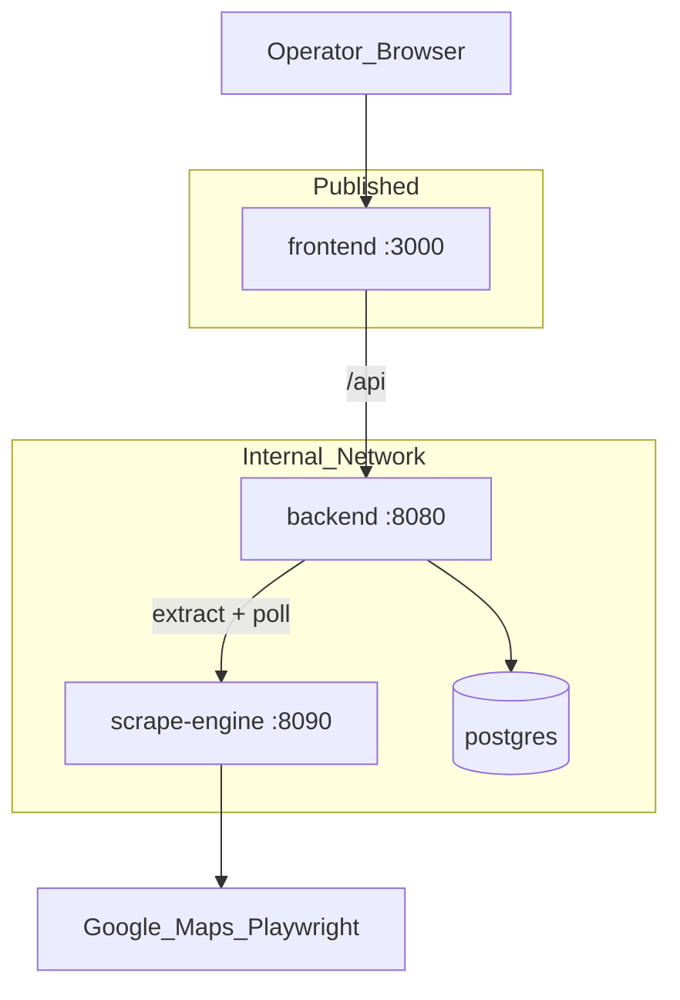

# Contributing to Huginn

## Scope

Huginn is a compose-first lead discovery app: **frontend → backend → scrape-engine → postgres**.

Avoid SaaS multi-tenancy, CAPTCHA bypasses, anti-bot evasion, or distributed worker infrastructure.

## Brand

Product logo and favicon live at [`apps/frontend/public/favicon.ico`](apps/frontend/public/favicon.ico). The UI brand mark is [`apps/frontend/src/components/Brand.jsx`](apps/frontend/src/components/Brand.jsx) (mint/navy theme in `styles.css`). Keep the raven asset as the canonical logo when updating the SPA or README header.

## Architecture

Canonical diagrams live in [README.md — Architecture](README.md#architecture). Summary of the running Compose system:



## Layout

- `apps/frontend` — Vite React + Leaflet
- `cmd/backend` — JWT gateway + sessions/leads
- `cmd/scrape-engine` — extraction only
- `internal/upstream` — inherited Maps engine (MIT boundary)

## Development

```bash
go test ./...
cd apps/frontend && npm install && npm run build
docker compose up --build
```

Live browser tests (opt-in):

```bash
HUGINN_LIVE=1 go test -tags=live ./internal/scraper -run Live -count=1
```

When syncing extraction code from [gosom/google-maps-scraper](https://github.com/gosom/google-maps-scraper), update `NOTICE.md` and keep product logic out of `internal/upstream`.

Full onboarding and API notes: [README.md](README.md).
